Stuff I find on the interwebs:

1. Interesting paradigms, principles and phenomenons:
   * [Lindy effect](https://en.wikipedia.org/wiki/Lindy_effect) —
     presently older things have the longer expected lifespan;
   * [Shirky principle](https://en.wikipedia.org/wiki/Clay_Shirky#Shirky_principle) —
     institutions will preserve problems to justify existence;
   * [Software monoculture](https://en.wikipedia.org/wiki/Monoculture_(computer_science)) —
     using software that everyone else uses makes you most likely to be targeted
     and leaves you vulnerable to the catastrophic "99% attack."

   Think how these apply to software-engineering and your life.
2. If you're into Eastern philosophy,
   read the [Unix koans](http://catb.org/~esr/writings/unix-koans/).
   They rip!
3. SLOC size (or KB size) per unit featureset has [always been a great metric][sloc-bugs]!
3. De-google to [Alt-Power](https://altpower.app) or a similar feature-rich
   search engine of which now there are a few.
4. Get familiar with common [dark patterns](https://en.wikipedia.org/wiki/Dark_pattern)
   and try to think of reasons to avoid them.
5. [Commercial fusion](https://en.wikipedia.org/wiki/List_of_fusion_experiments)
   is finally here—if your country has access to ocean water,
   have your governments settle on nothing less!
6. _"There’s a lot of opportunity in becoming a wireless telegraph operator.
   Learn a profession with a great future!"_  
   — a 1911 wireless-telegraphy ad

[sloc-bugs]: https://softwareengineering.stackexchange.com/questions/185660/is-the-average-number-of-bugs-per-loc-the-same-for-different-programming-languag
[#]: https://www.worldradiohistory.com/UK/Wireless-World/MARCONIGRAPH/Marconigraph-1911-11.pdf

-----

## Dev tools

## Science & Technology

## GUI / X11

## HTML & Web

## OpSec

